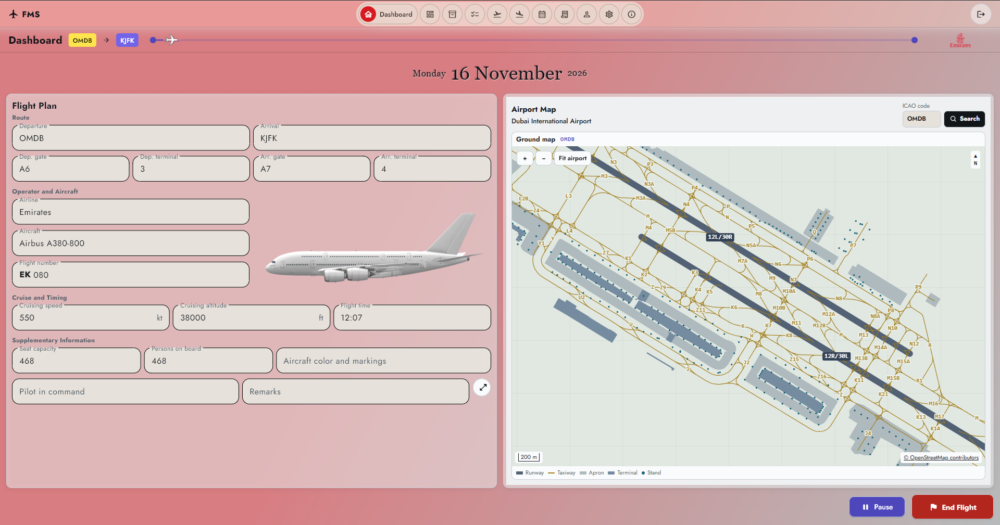
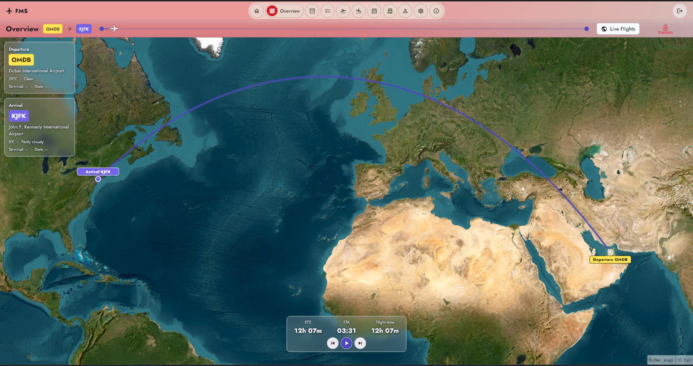
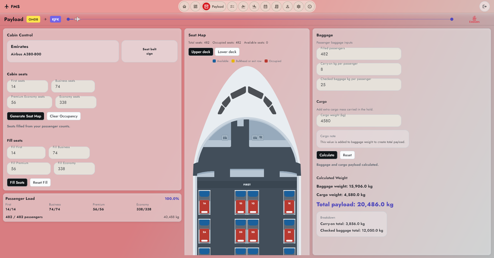
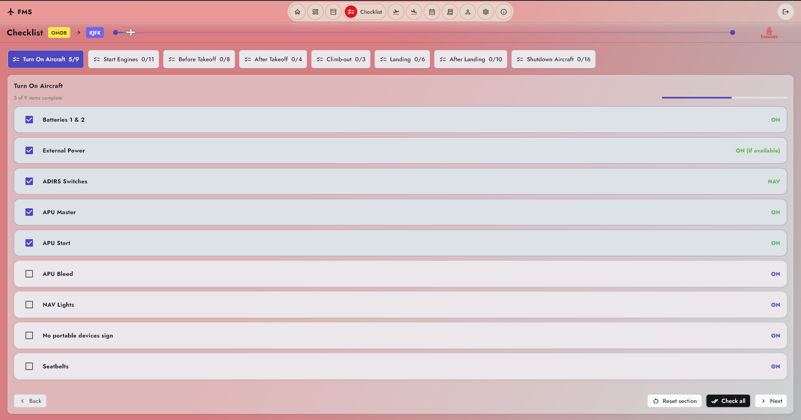
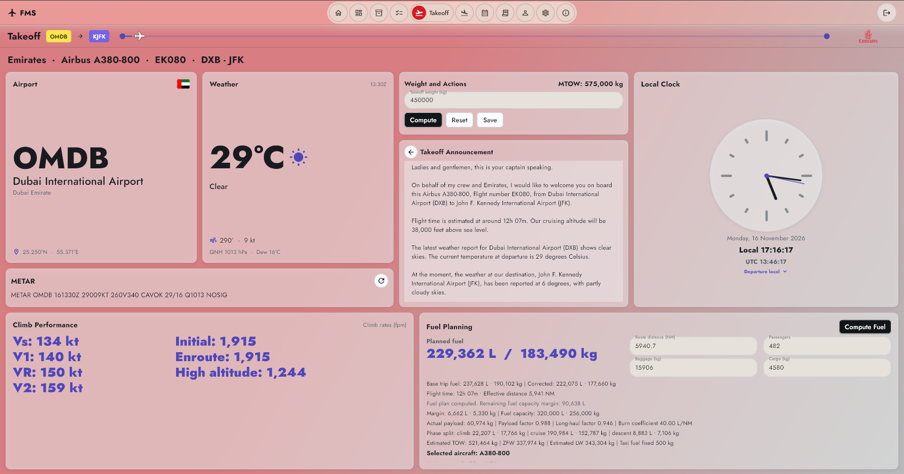
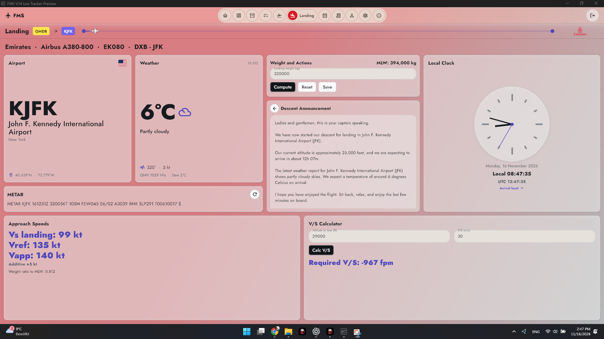

# Flight Management Systems — V14 Public Portfolio Edition

Your flight simulator gives you the cockpit. FMS gives you the dispatch desk. Plan your route, estimate fuel and flight time, and brief both airports with weather and maps. Run your checklists, then give the captain’s welcome you’ve heard a hundred times: “Ladies and gentlemen, welcome aboard.” Once airborne, watch your aircraft move across the live Infinite Flight map. Running out of time before touchdown? Pause your flight in FMS, save your progress, and come back to finish the journey when you’re ready.

> **Aviation safety warning:** This software is an educational and simulation project. It is not certified, approved, validated, or suitable for real-world flight planning, navigation, aircraft performance calculations, dispatch, or flight operations. Never use its calculations, weather data, maps, or outputs for an operational or safety-critical decision.

## Features

- Airline and aircraft selection with airline-aware presentation.
- Home and overview dashboards with route, flight-status, checklist, ramp-status, and progress views.
- Passenger seating, cabin distribution, baggage estimation, and cargo/payload tools.
- Simulation-oriented takeoff, landing, descent, vertical-speed, and fuel-planning interfaces.
- METAR retrieval and airport weather context.
- Interactive maps and a bundled local Globe.gl route visualization.
- Calendar planning, JSON import/export, completed-flight logs, and flight hibernation/restore.
- A local pilot profile with activity and career statistics.
- Optional Infinite Flight live tracker with traffic, routes, and airport context.
- Display, performance, audio, unit, custom-airline, background, and data-management settings.

## App walkthrough

### Dashboard
Choose your departure and arrival airports, airline, and aircraft. Enter your flight details and explore the departure airport on the map.



### Overview
See your route, airport weather, estimated flight time, and progress in one view.



### Payload
Use the seat map to see where passengers are seated. Enter baggage and cargo weights to see how much load you’re adding.



### Checklist
Open the checklist for your current stage of flight and mark items complete as you go.



### Takeoff
Enter runway, weather, and aircraft weight to estimate takeoff speeds and runway distance. Use Fuel Planning to estimate how much fuel to carry.



### Landing
Enter arrival runway conditions and expected landing weight to estimate approach speed and landing distance.



## Requirements

- Windows 10 or Windows 11.
- Python 3.12 with the Windows `py` launcher.
- Microsoft Edge WebView2 Runtime for the local Globe.gl view.
- Internet access for live maps, weather, METAR, geocoding, and Infinite Flight features.

## Windows setup

Download and extract the repository ZIP. Open PowerShell in the extracted folder and run:

```powershell
.\Start-FMS.cmd
```

You can also double-click `Start-FMS.cmd`. It creates a local Python environment, installs the dependencies on first run, and opens FMS. Later runs reuse the environment.

For the portable edition, extract the Windows ZIP attached to the GitHub release and open `FMS V14 Public.exe`. Keep the `_internal` folder beside the executable. The portable edition includes Python.

## Environment variables

Optionally enable MapTiler tiles for the current PowerShell session:

```powershell
$env:MAPTILER_API_KEY="your_maptiler_api_key_here"
```

Optionally enable Infinite Flight live-data features:

```powershell
$env:INFINITE_FLIGHT_API_KEY="your_infinite_flight_api_key_here"
```

`.env.example` documents the variable names, but the application does not automatically load a `.env` file. Never commit real keys or `infinite_flight_config.json`.

## Run

Run the public no-login application from the project root:

```powershell
.\Start-FMS.cmd
```

The app opens directly with the local display name `User`. On Windows, this edition stores its data under `%LOCALAPPDATA%\Flight Management Systems Public`.

## Project structure

```text
.
├── flightmanagementsystems_public.py   # Public no-login application
├── assets/                             # Runtime images, icons, and audio
├── globe-gl-test-web/dist/             # Local Globe.gl bundle used by the app
├── requirements.txt                    # Python runtime dependencies
├── .env.example                        # Secret-free environment template
├── LICENSE                             # MIT License
└── *.md                                # Security, copyright, contribution, and notices
```

Runtime data—including `calendar_flights.json`, `profile_data.json`, `app_settings.json`, `infinite_flight_config.json`, `flight_hibernation.json`, exports, logs, and caches—is excluded by `.gitignore`.

## Privacy and security

- Local JSON files may contain profile information, routes, flight history, settings, or API credentials.
- Saving an Infinite Flight key inside the application stores it locally using Windows DPAPI. Prefer the environment variable.
- Do not place real keys, credentials, personal routes, private callsigns, profile data, or diagnostic logs in issues or screenshots.
- Revoke and replace any credential that is accidentally exposed.
- See `SECURITY.md` before reporting a vulnerability.

## Assets and third-party content

This package contains third-party libraries and may contain third-party photographs, aircraft imagery, airline and manufacturer logos, maps, textures, icons, backgrounds, and audio. Some content does not yet have confirmed redistribution records. Public availability does not establish permission to redistribute third-party material.

Verify or replace every asset whose ownership, licence, attribution, trademark status, or redistribution permission has not been confirmed. See `THIRD_PARTY_NOTICES.md` for the detailed inventory.

## License

The original source code for Flight Management Systems V14 is licensed under the [MIT License](LICENSE). Third-party components and assets retain their own terms. See [Third-party notices](THIRD_PARTY_NOTICES.md).

## Author

Sam Samadi

